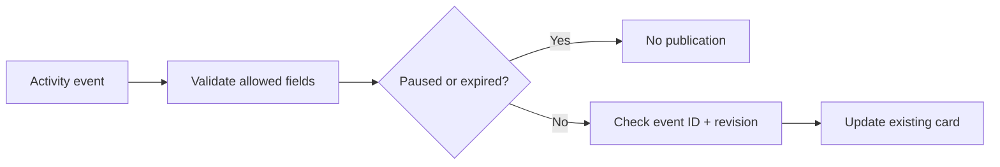

<p align="center">
  <a href="https://4stoic.me"></a>
</p>

<h1 align="center">4Stoic</h1>
<p align="center">Websites. Discord systems. The infrastructure behind them.</p>
<p align="center">
  <a href="https://4stoic.me">Personal site ↗</a> ·
  <a href="https://nevlu.net">Nevlu</a> ·
  <a href="https://avolet.ca">Avolet</a> ·
  <a href="https://elvani.app">Elvani</a>
</p>

## On the workbench

<table>
<tr><th align="left">Project</th><th align="left">What I'm building</th><th align="left">Current state</th></tr>
<tr><td><strong><a href="https://nevlu.net">Nevlu</a></strong></td><td>The development team and company behind the projects.</td><td>Coming-soon site</td></tr>
<tr><td><strong><a href="https://avolet.ca">Avolet</a></strong></td><td>Build. Grow. Automate.<br>Website delivery, ongoing improvement and controlled automation, across Public, Core and Connect.</td><td>In development</td></tr>
<tr><td><strong><a href="https://elvani.app">Elvani</a></strong></td><td>Discord tools for identity, tickets, moderation and service status.</td><td>In development</td></tr>
<tr><td><strong><a href="https://4stoic.me">4stoic.me</a></strong></td><td>A cinematic personal site with a film-to-profile transition.</td><td>Live</td></tr>
</table>

The three business sites currently show Coming Soon pages. Product links are public destinations, not claims that the full applications have launched.

## Engineering, beyond the interface

Clear boundaries. Repeatable actions. Useful failure states.

A small example of the approach: an activity event should respect the owner's pause control, expire when it becomes stale, and update the same message when retried.



<details>
<summary><strong>Open the TypeScript sketch</strong></summary>

An original, standalone illustration of the publish boundary. This is not extracted private product source.

```ts
type Activity = {
  id: string;
  kind: "build" | "review";
  expiresAt: number;
};

type State = {
  paused: boolean;
  lastEventId?: string;
  current?: Activity;
};

function publish(state: State, event: Activity, now: number): State {
  if (state.paused || event.id === state.lastEventId) return state;
  if (!["build", "review"].includes(event.kind)) return state;
  if (!Number.isFinite(event.expiresAt) || event.expiresAt <= now) return state;
  return { ...state, lastEventId: event.id, current: { ...event } };
}

function visible(state: State, now: number): Activity | null {
  if (state.paused || !state.current) return null;
  return state.current.expiresAt > now ? state.current : null;
}
```

This sketch prevents an immediate repeat. A production implementation also needs authentication, runtime validation, durable bounded idempotency, revision checks and concurrency control.

</details>

### Tools in the current projects

TypeScript · Node.js · React · Python · SQLite · Discord integrations · Docker · Caddy

The scoped activity connector is in progress. Its endpoint is deployed; client authentication and the complete tool-to-Discord path are still being verified.

## Elsewhere

[4stoic.me ↗](https://4stoic.me) — the cinematic personal side.
